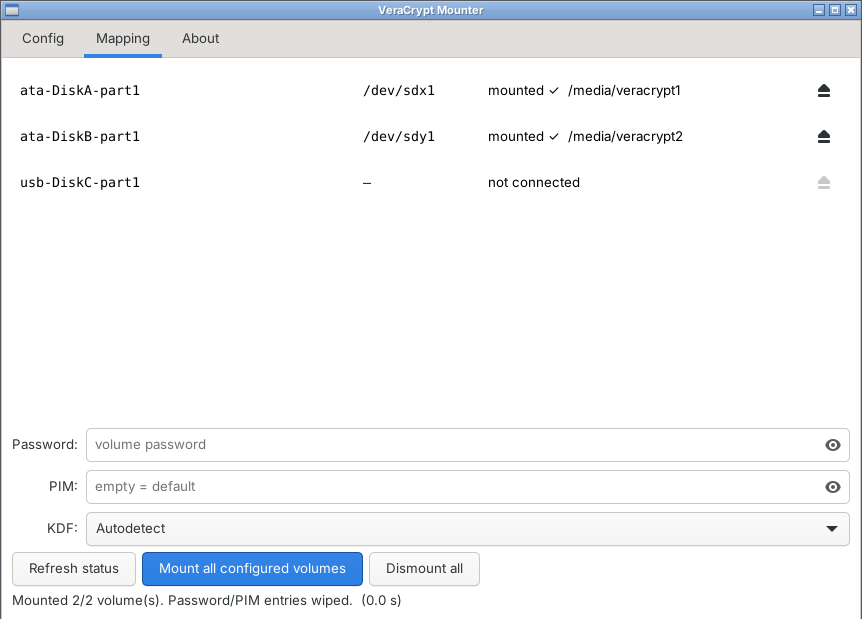

# vc-mounter

A small GTK4 desktop tool for Linux that mounts several VeraCrypt volumes with
one password, in parallel, and finds them by stable device ID instead of by
`/dev/sdX` names that change between boots.



vc-mounter is a front end to the `veracrypt` command line program. It is not
affiliated with VeraCrypt or IDRIX.

## Features

- **Stable device identification.** Volumes are stored as `/dev/disk/by-id/…`
  paths and resolved to the current `/dev/sdXY` at mount time.
- **One password, all volumes, in parallel.** Key derivation runs for all
  volumes at the same time, so four disks take about as long as one.
- **Per-volume and global dismount**, with a guarded "force dismount" for
  volumes that are busy, and a list of the programs holding a busy volume.
- **Tray icon** with an open or closed padlock, and optional start at login.
- **Careful handling of secrets** (see [Security](#security)).

## Requirements

- Linux with GNOME. Developed and tested on Ubuntu 26.04.
- VeraCrypt **1.26.30 or newer**, with the `veracrypt` program in `/usr/bin`.
- Python 3.10 or newer, GTK 4.10 or newer, PyGObject.
- polkit with `pkexec` and a running authentication agent (GNOME has one).
- `lsblk` and `dmsetup`.
- For the tray icon: `gir1.2-ayatanaappindicator3-0.1` and GNOME's
  AppIndicator extension. Without them the tool works, but closing the window
  quits it.

On Ubuntu:

```sh
sudo apt install python3-gi gir1.2-gtk-4.0 gir1.2-ayatanaappindicator3-0.1 dmsetup
```

VeraCrypt itself comes from <https://veracrypt.io>.

## Install

```sh
git clone https://github.com/AriZone/vc-mounter.git
cd vc-mounter
sudo ./install.sh
./vc-mounter
```

`install.sh` installs only the two parts that need root:

| File | Purpose |
|---|---|
| `/usr/libexec/vc-mounter/vc-mounter-helper` | Root helper that calls `veracrypt` |
| `/usr/share/polkit-1/actions/eu.arizone.vcmounter.policy` | polkit action for the helper |

The GUI (`vc-mounter` and `vc-mounter-tray`) runs from the folder you cloned.
Run `sudo ./install.sh` again after every update, because the helper is part
of the program. To remove the root parts: `sudo ./install.sh --uninstall`.

## Usage

1. **Config tab.** Tick the partitions that are VeraCrypt volumes and click
   *Save selection*. Tick *Start at login* if you want the tool to wait in
   the tray after logon.
2. **Mapping tab.** Enter the password, and the PIM if you use one, and click
   *Mount all configured volumes*. polkit asks for an administrator password.
   Volumes appear under VeraCrypt's default mount points,
   `/media/veracrypt1`, `/media/veracrypt2`, and so on.
3. **Dismount** a single volume with the eject button at the end of its row
   or by right-clicking the row; *Dismount all* dismounts every VeraCrypt
   volume on the system, including ones mounted by other means.
4. **Busy volumes.** If a volume cannot be dismounted, its row names the
   programs holding it. Close them and try again. *Force dismount* uses
   VeraCrypt's emergency unmount: the folder disappears at once, but the
   decrypted device and its key stay in memory until those programs let go.
   Programs writing at that moment can lose data, so treat it as a last
   resort.

**KDF.** Leave the KDF on *Autodetect* unless mounting is too slow for you.
VeraCrypt then tries every KDF. A KDF you name is passed to VeraCrypt as
`--hash=NAME` and is visible in the process list while the volume is mounted.

## How it works

```
vc-mounter (GUI, your user)
   │  pkexec … vc-mounter-helper mount /dev/sdc1 /dev/sdd1 …
   │  stdin: password, PIM, KDF
   ▼
vc-mounter-helper (root, root-owned file)
   │  one `veracrypt --text …` per device, in parallel
   ▼
veracrypt
```

The GUI contains no code that runs as root. The helper is a separate file
owned by root, so a program running as your user cannot change what runs with
root rights. The helper accepts only existing block devices under `/dev`, a
numeric PIM and a KDF from a fixed list, and it runs `veracrypt` with a fixed
`PATH` and locale.

### Parallel mounting and VeraCrypt's tracking folders

VeraCrypt keeps a small "tracking" mount per volume in
`$TMPDIR/.veracrypt_aux_mntN` and chooses `N` without locking. Two `veracrypt`
processes that start at the same moment can choose the same folder. One
volume is then decrypted and mounted but no longer known to VeraCrypt, and
VeraCrypt reports its mount as failed.

The helper avoids this, and limits the damage if anything else goes wrong:

- Every `veracrypt` process gets a private `TMPDIR` under `/run/vc-mounter`,
  so no two can choose the same folder. VeraCrypt still finds all volumes,
  because it looks for tracking mounts by name, wherever they are.
- Every device gets its own VeraCrypt slot.
- A device that already carries a decrypted mapping is never mounted again.
- Nothing is retried. If a mount fails or is cancelled, whatever it left
  behind is taken down and the error is shown.
- Dismount also takes down a decrypted volume that VeraCrypt has lost track
  of, by unmounting it and removing its device-mapper device. Never by force.

`tests/stress-parallel.sh` checks this. It mounts four throwaway containers
on loop devices in parallel, round after round, and verifies that each is
decrypted exactly once and still tracked:

```sh
sudo tests/stress-parallel.sh 20
```

It touches no real disk, and it refuses to run while any VeraCrypt volume is
mounted.

## Security

What vc-mounter does to protect the password and PIM:

- They are typed into entries backed by GTK's secure buffer (locked memory
  where the platform allows, zeroed on free), with no visible length.
- They reach the helper over a pipe, and `veracrypt` through its own
  password and PIM prompts. They never appear on a command line, in the
  environment, in a file, or in the system log.
- The GUI and the helper mark themselves non-dumpable: no core dumps, and no
  other process of the same user can read their memory.
- The entries are cleared after a successful mount, when the window is
  hidden to the tray, and on quit.
- The configuration file holds device IDs only and is created with mode 600.

What it does not protect against:

- **A compromised user account.** A program running as you can replace the
  GUI or watch your input. The root-owned helper keeps such a program from
  gaining root through vc-mounter; it does not protect the password.
- **Python memory.** To hand the password to the helper it passes through
  ordinary Python objects, which cannot be wiped. Keep swap encrypted.
- **A named KDF.** It is visible in the process list, as described above.
- **Anyone with root, or with access to the machine while volumes are
  mounted.** Mounted volumes are readable like any other folder.

**Authentication memory.** The polkit action uses `auth_admin_keep`: after
one authentication, the same running vc-mounter may mount and dismount again
without a new prompt until the authorisation expires. polkit's default is
5 minutes. To shorten it for the whole system, set `ExpirationSeconds` in
`/etc/polkit-1/polkitd.conf` (recent polkit versions).

## Limitations

- All volumes mounted in one go share one password, PIM and KDF. A wrong
  password stops the remaining volumes instead of trying each one.
- Only partitions can be configured: no whole-disk volumes, no file
  containers, no keyfiles, no hidden-volume protection.
- Mount points are VeraCrypt's defaults.
- A volume that is "not a VeraCrypt volume" and a wrong password look the
  same to VeraCrypt, and therefore to this tool.

## Files

| Path | Content |
|---|---|
| `~/.config/vc-mounter/config.json` | The configured device IDs |
| `~/.config/autostart/vc-mounter.desktop` | Present while *Start at login* is ticked |
| `/run/vc-mounter/` | Private temp folders of running mounts (cleared on reboot) |

## Licence

ISC. See [LICENSE](LICENSE).
